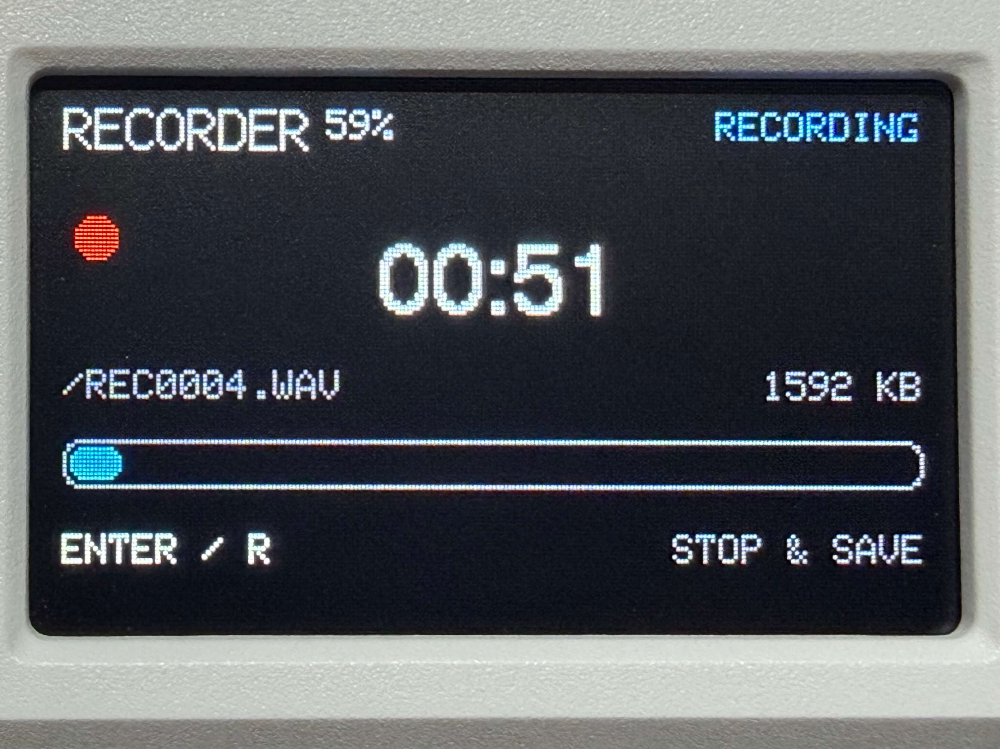
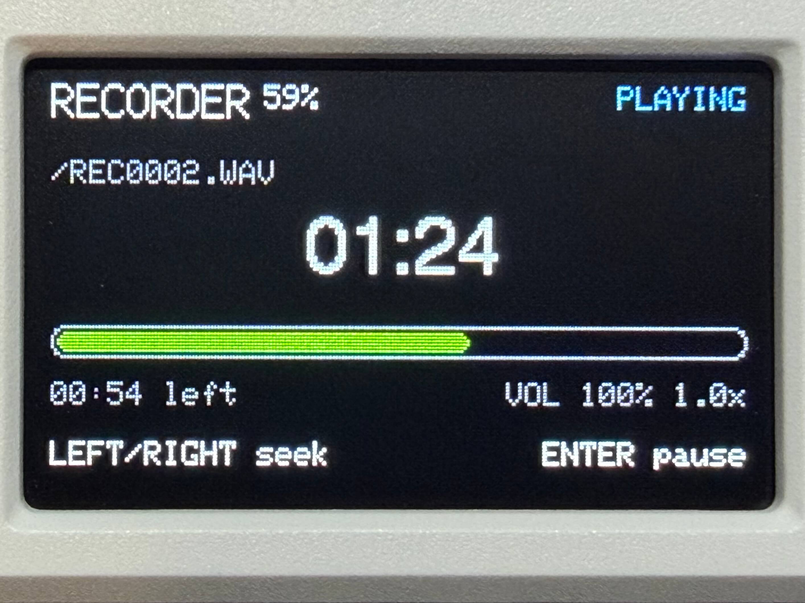
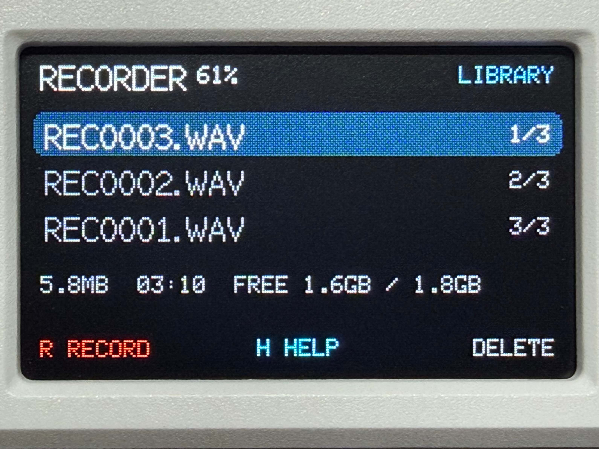
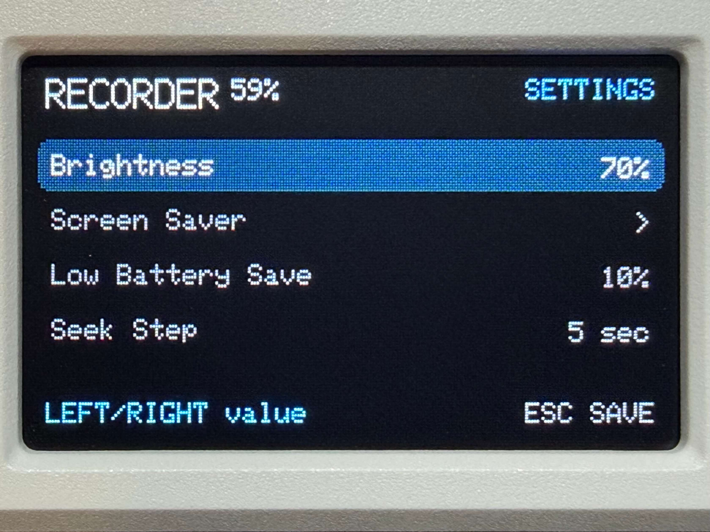
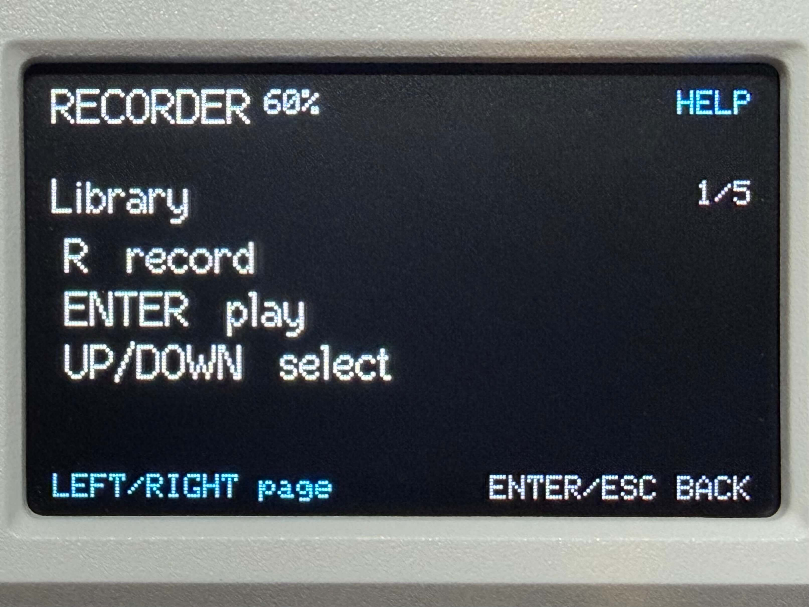
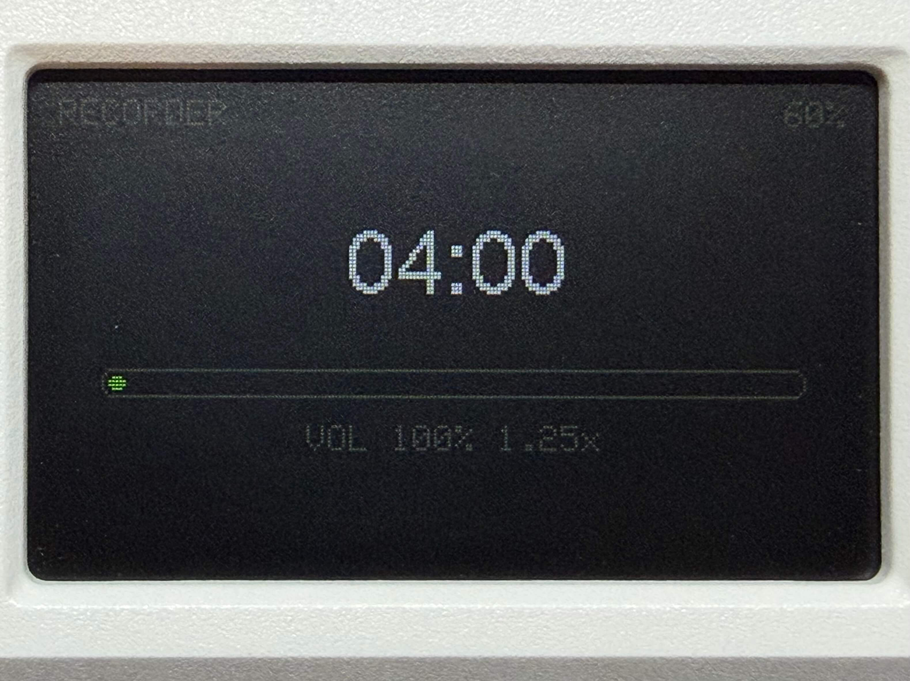

# Cardputer ADV Recorder

A voice recorder and WAV player for the M5Stack Cardputer ADV.

The firmware records 16 kHz, mono, 16-bit PCM WAV files directly to microSD.
Recording and playback are streamed through fixed-size buffers, so file length
is not limited by available RAM.

> Only Cardputer ADV is supported. The original Cardputer uses different audio
> hardware and is not compatible with this firmware.

## Screenshots

<p align="center">
  
  
  
</p>

<p align="center">
  
  
  
</p>

## Features

- Stream recordings to microSD as `/RECDDMMYYYY_HHMM.WAV` (local start time) once a
  desktop sync has set the clock, or `/REC0001.WAV` through `/REC9999.WAV` before
  that (the ADV has no battery-backed clock). The newest recording is listed first.
- Browse, play, rename, lock, and delete WAV files from the device.
- Pause, seek, and adjust playback volume while listening.
- Show recording level, elapsed time, file size, battery status, SD free
  space, and selected-file details.
- Configure display brightness and screen saver behavior from the device.
- Keep recording or playback running while the screen is dimmed or off.
- Auto-save an active recording at the configured low battery threshold.
- Recover from missing cards, low space, and storage errors.
- Finalize WAV headers and sync storage before presenting a recording as saved.

## Requirements

- M5Stack Cardputer ADV
- Writable FAT32 microSD card
- PlatformIO Core 6.1.19 or PlatformIO IDE

## Build and upload

```sh
platformio run
platformio run --target upload
```

For serial logs over USB, flash the debug build instead (the release build
sends `Serial` to the UART pins):

```sh
platformio run -e cardputer-adv-recorder-debug --target upload
platformio device monitor
```

Release firmware is published as a complete image. Flash it at offset `0x0000`:

```sh
esptool.py --chip esp32s3 --baud 460800 write_flash \
  0x0000 cardputer-adv-recorder-vX.Y.Z.bin
```

To run it from [M5Launcher](https://github.com/bmorcelli/Launcher) instead,
copy `cardputer-adv-recorder-vX.Y.Z-m5launcher.bin` (app only) to the SD card
and install it from Launcher. Pairing is kept in NVS, so it survives switching
apps, but anything that erases NVS (a full flash erase, changing Launcher's
partition scheme) means pairing again.

The serial monitor runs at 115200 baud. To run host-side tests (needs a host
`gcc`/`g++` on `PATH`; on Windows, MinGW-w64 installed in a path without
spaces):

```sh
platformio test -e native-tests
```

## Sync with the desktop app

**Pair once.** Hold `G0` for settings, open `Sync`, choose `Pair with
Desktop`. The device scans WiFi networks, then advertises over Bluetooth for
two minutes. In the desktop app choose Devices > Pair new device. Both
screens show a six-digit code; if they match, press `Enter` on the Cardputer
and click Codes match on the desktop. The desktop then sends your WiFi
network and password over the encrypted Bluetooth link, and the device tests
it once. One desktop owns the device; pairing another replaces it.

**Sync.** Press `S` in the library. The device joins the paired WiFi,
serves the `/v1` protocol over HTTPS on port 8443 with mutual TLS (it only
answers the paired desktop, and the desktop only trusts this device's key),
and announces itself as `_cprec._tcp.local` so the desktop finds it without
an address. With auto-sync on in the desktop app, the sync then runs by
itself. `Esc` leaves sync mode; the desktop ends it when a sync finishes, and
it ends on its own after 3 minutes (auto) or 10 minutes (`S`) with no
desktop. Bluetooth and WiFi are off in every other state.

**Auto-sync when charging** (Settings > Sync, default on): when the device
is idle in the library on external power, paired, and has recordings the
desktop does not have, it starts sync mode by itself. The Cardputer ADV has
no charge-status signal, so "external power" means a computer on the USB port
or a battery at charging voltage (4.15 V and up). After any sync it waits 10
minutes before trying again; `Esc` stops it until the device is unplugged.
The library header shows `USB` on external power and how many recordings are
new (or `synced`).

`Sync` settings: Pair with Desktop, Sync over Bluetooth (for when the
device cannot reach WiFi; also offered on the sync screen when joining
fails), Paired With, WiFi (set from the desktop:
Devices > Change WiFi, with the device in pairing mode), Delete After Sync,
Auto-Sync Charging, and Forget Pairing (press `Enter` twice; wipes the peer, WiFi credentials and
sync acks). Protocol details: [`../docs/ble-protocol.md`](../docs/ble-protocol.md).

Every new recording carries a `cprc` RIFF chunk (random 128-bit recording id,
device id, start time) before `data`; other players skip it. Older files get
an id derived from name, size and SD timestamp. Ids, cached hashes and acks
are kept in `RECORDER.SYN` on the card. The device id comes from a P-256 key
pair generated on first boot and stored in NVS. Serial output logs free heap
and per-file transfer speed during sync.

Memory: the StampS3 has no PSRAM. The 80 KB of audio buffers are allocated
only while recording or playing and released when sync or pairing starts,
so WiFi and one TLS session fit (measured: about 270 KB/s, 70 KB of heap to
spare). What the first device runs taught us is in
[`../docs/hardware-findings.md`](../docs/hardware-findings.md).

## Project layout

- `src/app`: recorder state flow, UI, settings, screen saver, file browser,
  the sync and pairing screens (`sync_flow.cpp`, `pairing_flow.cpp`), the
  Bluetooth sync fallback (`ble_sync_flow.cpp`), and the audio/radio memory
  handover (`memory.cpp`).
- `src/hardware`: Cardputer ADV board, audio, power, microSD, WiFi and BLE
  (NimBLE) services.
- `src/media`: WAV parsing, writing, the `cprc` chunk, and recording filename
  helpers.
- `src/sync`: sync index, `/v1` encoding, SHA-256, CBOR, pairing math, device
  identity (P-256 key, TLS certificate), peer store, AES-GCM channel, the
  transport-independent `/v1` handler (`sync_handler.cpp`) and the HTTPS
  server. The pure parts are host-tested (`test_sync`,
  `test_pairing`).

## Controls

| Key | Action |
| --- | --- |
| `R` | Start recording |
| `S` in library | Start sync mode (after pairing) |
| `Esc` in sync mode | Stop syncing |
| `H` in library | Open help |
| `Enter`, `Esc`, or `R` | Stop and save a recording |
| Up/Down key positions (`;` / `.`) | Select a recording |
| `Enter` | Play the selected recording |
| `Enter` during playback | Pause or resume playback |
| `Esc` during playback | Stop playback |
| Left/Right during playback (`,` / `/`) | Seek backward or forward by the configured seek step |
| Up/Down during playback | Adjust volume |
| `[` / `]` during playback | Decrease or increase playback speed |
| Left in library (`,`) | Lock or unlock the selected recording |
| Right in library (`/`) | Rename the selected recording |
| `Delete` in library | Ask to delete the selected recording |
| `Enter` after `Delete` | Confirm deletion |
| Short `G0` press | Manually enter the configured screen saver mode |
| Long `G0` press | Open settings |
| Left/Right key positions (`,` / `/`) | Change a setting value |
| `Esc` in settings | Save settings or return from a submenu |
| `Enter` in rename | Save the new name |
| `Delete` in rename | Remove the last character |
| `Esc` in rename | Cancel rename |
| Left/Right in help | Change help page |
| `Enter` or `Esc` in help | Close help |

## Settings

Settings are saved on the device and restored after reboot. Brightness is
applied immediately. Screen saver options are grouped under `Screen Saver`:

| Setting | Values |
| --- | --- |
| Brightness | 10% through 100%, in 10% steps |
| Low Battery Save | Off, 1%, 5%, 10% |
| Seek Step | 5 sec, 10 sec, 20 sec, 60 sec |
| Sync | Pair with Desktop, Paired With, WiFi, Delete After Sync, Auto-Sync Charging, Forget Pairing (see Sync above) |
| Sync / Delete After Sync | Off (default), On. Deletes a file after the desktop's verified ack; never deletes locked files |
| Clear Recordings | Deletes all unlocked recordings after a second `Enter` |
| Reset to Default | Restores saved settings after confirmation |
| Version | Current firmware version |
| Screen Saver / When Home | Off, Dimmed Standby, Black |
| Screen Saver / While Recording | Off, Dimmed Standby, Black |
| Screen Saver / While Playing | Off, Dimmed Standby, Black |
| Screen Saver / Triple-Press Wake | Off, On |

`Low Battery Save` defaults to `10%`. When it is enabled and battery data is
valid, recording stops through the normal save path once the battery reaches
the selected threshold.

`Dimmed Standby` shows a low-brightness status screen. `Black` turns the
display off. Recording and playback continue in both modes; the first key
press wakes the screen and is not used as a stop, delete, or volume command.
When `Triple-Press Wake` is on, the same key must be pressed three times to
wake from `Dimmed Standby` or `Black`.

`Reset to Default` asks for confirmation before restoring brightness, screen
saver, triple-press wake, low battery save, and seek step to their defaults.

Playback speed starts at `1.0x` each time playback begins and can be changed
live from `0.75x` through `2.0x`. Speed changes adjust the playback sample
rate, so pitch changes with speed.

## File management

The library sorts recordings by filename descending so newer default names are
near the top. Locked recordings show `*` before the filename and cannot be
deleted until unlocked. Lock state is stored on the card in `RECORDER.LCK`;
if the file is missing or damaged, recordings remain usable.

Rename keeps the `.WAV` suffix automatically. Names are converted to uppercase
and accept letters, numbers, spaces, `_`, and `-`. Existing files are never
overwritten.

## Audio format

New recordings use 16 kHz mono 16-bit PCM. Playback accepts mono 16-bit PCM
WAV files and walks RIFF chunks instead of requiring audio to begin at byte 44.

See [audio and storage notes](docs/audio-and-storage.md),
[troubleshooting](docs/troubleshooting.md), and the
[hardware test checklist](docs/hardware-test-checklist.md).

## License

[MIT](LICENSE)
